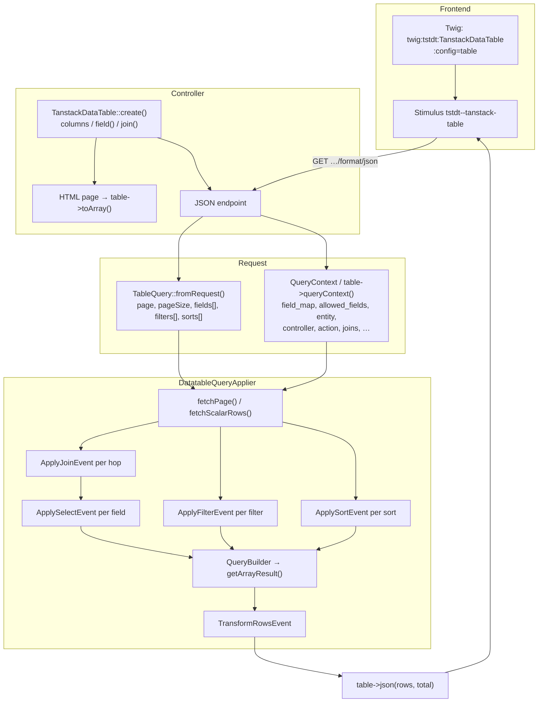

# Big picture

How `TanstackDataTable` (frontend config) connects to Doctrine via
`DatatableQueryApplier` and Symfony’s event/subscriber model. See also
[Events & Subscribers](EVENTS.md) for the doc index.

---

The table UI never talks to Doctrine directly. The controller builds a
`TanstackDataTable` (columns, URLs, filters), the Stimulus table requests
JSON with `fields[]` / `filters[]` / optional `sorts[]`, and the JSON action
uses `TableQuery` + `DatatableQueryApplier` to mutate a `QueryBuilder` **one
field at a time** through events. After fetch, a final transform pass maps
raw DB values to client-friendly JSON.



| Piece | Role |
|-------|------|
| `TanstackDataTable` | Declares columns, `Column::field()` / `Column::join()`, filter types, JSON URL. `queryContext()` builds the applier bag. |
| `QueryContext` | Typed builder for `field_map`, `joins`, `allowed_fields`, `entity`, … |
| `TableQuery` | Parses `page` / `pageSize` / `fields[]` / `filters[]` / `sorts[]`. |
| `DatatableQueryApplier` | Dispatches join → select/filter/sort → transform; `fetchPage()` for COUNT + page. |
| Events | Per-field (or once for transform) payloads with `QueryBuilder` + context. |
| Subscribers | Whitelist, custom fields, defaults, joins, date formatting. |

## Preferred controller path

Declare joins on the column, build context from the table, use `fetchPage()`:

```php
Column::make('category')->field('c.name')->join('p.category');

$context = $table->queryContext(
    Product::class,
    extraAllowed: ['status'],
    datetimeFormats: ['createdAt' => 'Y-m-d'],
    controller: self::class,
    action: __FUNCTION__,
);

[$rows, $total] = $this->queryApplier->fetchPage(
    fn () => $this->em->createQueryBuilder()->from(Product::class, 'p'),
    $query,
    $context,
    'p.id', // default ORDER BY p.id DESC when query has no sorts
);
```
