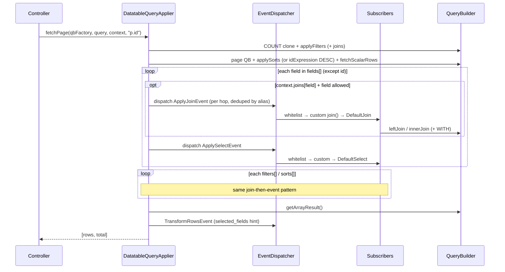

# End-to-end sequence (`fetchScalarRows` / `fetchPage`)

Sequence of joins, selects, filters, sorts, and transform inside
`DatatableQueryApplier`. See also [Events & Subscribers](EVENTS.md) for the
doc index.

---

