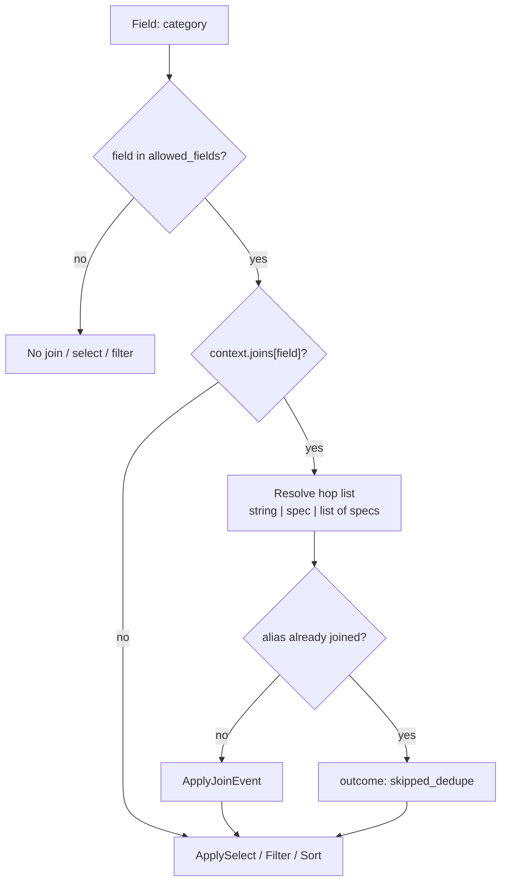

# Per-field join pipeline

How `Column::join()` / `context.joins` become `ApplyJoinEvent` hops on the
`QueryBuilder`. See also [Events & Subscribers](EVENTS.md) for the doc index.

---

Joins are **lazy and per-field**: the root QB is only `FROM Product p` (or similar)
until a selected / filtered / sorted field needs a relation. Then the applier
dispatches one `ApplyJoinEvent` per hop **before** that field’s select/filter/sort.



## Column API (preferred for default joins)

```php
Column::make('category')->field('c.name')->join('p.category');
Column::make('customer')->field('c.name')->join('o.customer', alias: 'c');
Column::make('country')->field('c.country')->joins([
    ['path' => 'i.order', 'alias' => 'o'],
    ['path' => 'o.customer', 'alias' => 'c'],
]);
// optional: type: 'inner', condition: 'c.active = true'
```

Legacy context shapes still work: `'category' => 'p.category'` or
`['alias' => 'c', 'path' => 'p.category']`.

## Attribute join (preferred for custom `join()` listeners)

When an app subscriber owns the hop, declare it on
`#[AsTanStackDatatableField(..., join: 'p.category', joinAlias: 'c')]` instead of
`Column::join()`. That still populates context joins (via
`DatatableFieldJoinEnricher`) so `ApplyJoinEvent` is dispatched, without a
column hop that the listener would ignore. See
[Custom field subscribers](CUSTOM_FIELD_SUBSCRIBERS.md).

---

## Walkthrough: Catalog `category` column

Concrete path using the demo products table
(`CatalogController` → `DatatableQueryApplier` → `DefaultJoinSubscriber`).

### 1. Controller declares the column

```php
Column::make('category')
    ->field('c.name')      // DQL expression (alias c must exist)
    ->join('p.category');  // association path from root alias p
```

`Column::join()` stores a hop on the column:

```php
['path' => 'p.category', 'type' => 'left']
// alias omitted → inferred later from field() → "c"
```

No Doctrine join happens here — only column config for the HTML table and for
`queryContext()`.

### 2. JSON action builds context and calls `fetchPage`

```php
$table = $this->productsTable();
$query = TableQuery::fromRequest($request, $table->getPageSize());
$context = $table->queryContext(Product::class, extraAllowed: ['status'], …);

[$rows, $total] = $this->queryApplier->fetchPage(
    fn () => $this->em->createQueryBuilder()->from(Product::class, 'p'),
    $query,
    $context,
    'p.id',
);
```

`TanstackDataTable::queryContext()` returns a `QueryContext` (via
`QueryContext::fromTable()`):

1. `fieldMap()` → `'category' => 'c.name'`, …
2. `joinMap()` → `'category' => [['path' => 'p.category', 'type' => 'left']]`, …
3. Merges into `allowed_fields` (map keys + `extraAllowed`)
4. `fetchPage()` converts with `toArray()` before internal apply helpers; events
   still receive the array bag:

```php
[
    'field_map' => ['category' => 'c.name', 'sku' => 'p.sku', …],
    'allowed_fields' => ['sku', 'name', 'category', …, 'status'],
    'entity' => Product::class,
    'joins' => [
        'category' => [['path' => 'p.category', 'type' => 'left']],
    ],
    …
]
```

Still no JOIN on a QueryBuilder — only the context object / bag.

### 3. `fetchPage` / `fetchScalarRows` touch each selected field

`fetchPage()`:

1. COUNT QB via `countRows()` → applies filters (and any joins those filters need)
2. Page QB → default/request sorts → `fetchScalarRows()`

Inside `fetchScalarRows()`:

```text
SELECT p.id AS id
applySelects(fields without id)   ← joins happen here per field
applyFilters(...)                 ← joins again if filter field needs them
getArrayResult()
transformRows(...)
```

`applySelects()` loops fields. For `category` it always does **join first, then select**:

```php
$this->dispatchJoinsForField($qb, 'category', 'p', $context);
// then dispatch ApplySelectEvent for 'category'
```

The same `dispatchJoinsForField()` runs from `applyFilters()` / `applySorts()` when
the filter/sort field is listed in `context['joins']`. Each apply call resets the
in-memory `$joinedAliases` map; Doctrine’s `$qb->getAllAliases()` still prevents
double-joining on the same QB.

### 4. Resolve hops for this field

`dispatchJoinsForField('category', …)`:

1. **Whitelist gate (applier)** — if `allowed_fields` is set and `category` is not
   in it → return immediately (no join event).
2. **`resolveJoinsForField`** — read `context['joins']['category']`, normalize to a
   list of hops via `joinConfigAsList()` (string, single spec, or list of specs).
3. **`parseJoinItem`** for each hop:
   - path = `p.category`
   - type = `left`
   - alias missing → **`inferJoinAlias()`** scans `field_map['category']` =
     `c.name` for the first alias that is not the root (`p`) → **`c`**
4. Resulting hop: `{ alias: 'c', path: 'p.category', type: 'left', condition: null }`

If alias cannot be inferred and was not set, the hop is dropped (no event).

### 5. Dedupe, then dispatch `ApplyJoinEvent`

`dispatchOneJoin()`:

1. If alias `c` is already in `$joinedAliases` **or** `$qb->getAllAliases()` →
   skip dispatch, profiler outcome `skipped_dedupe` (e.g. Sales `customer` and
   `email` both use `join('o.customer', 'c')` — second field reuses the join).
2. Else create `ApplyJoinEvent` with field, alias, path, type, condition, context
   and `dispatch(..., ApplyJoinEvent::NAME)`.

### 6. Subscribers handle the event

| Priority | Subscriber | Role |
|----------|------------|------|
| `100` | `FieldWhitelistSubscriber` | If field not allowed → `handleAndStop()` (belt-and-suspenders; applier usually already skipped) |
| `10` (typical) | App `AbstractDatatableFieldSubscriber::join()` | Custom WITH / inner / etc. Call `handleAndStop()` if fully handled |
| `-100` | `DefaultJoinSubscriber` | Delegates to `LeftJoinApplicator` |

`LeftJoinApplicator::apply()`:

1. Skip if already handled / stopped
2. Safety regex on alias + path → else outcome `skipped_unsafe`
3. If alias already on QB → outcome `skipped_alias_present` + `handleAndStop()`
4. Else `$qb->leftJoin('p.category', 'c')` (or `innerJoin` / WITH variants)
5. Outcome `applied` + `handleAndStop()`

Applier records the alias in `$joinedAliases` when outcome is `applied` (or the
alias is present on the QB).

### 7. Select (filter / sort) uses the joined alias

After joins for `category`, `ApplySelectEvent` runs. `DefaultSelectSubscriber`
adds something like `c.name AS category` from `field_map`. The DQL is valid
because `c` exists.

Same pattern for a filter on `category`: join hops first, then
`ApplyFilterEvent` with expression rooted on `c`.

### 8. End state

For a request that selects `category` (and no prior join of `c`):

```sql
FROM App\Entity\Product p
LEFT JOIN p.category c
SELECT p.id AS id, c.name AS category, …
```

COUNT queries only join when a **filter** (or sort on the count path) needs the
relation — not for every column on the table.

---

## Mental model

```
Column::join('p.category')
  → joinMap() / queryContext()->… joins['category']
  → fetchPage(QueryContext) → applySelects|Filters|Sorts
  → dispatchJoinsForField (allowed? resolve hops, infer alias)
  → ApplyJoinEvent per hop (dedupe by alias)
  → whitelist → custom join() → DefaultJoin → LeftJoinApplicator
  → QB leftJoin/innerJoin
  → then select / filter / sort for that field
```

## Multi-hop and shared aliases

- **`joins([...])`** — ordered hops (e.g. `i.order` → `o`, then `o.customer` → `c`).
  Each hop is its own `ApplyJoinEvent`; earlier aliases must succeed for later
  paths like `o.customer` to resolve.
- **Shared alias** — two columns with the same join alias only apply the JOIN once
  per QB apply pass (`skipped_dedupe` on the second).
- **Explicit alias** — prefer `->join('o.customer', 'c')` when `field()` is a
  `CONCAT(...)` or otherwise hard to infer from.
