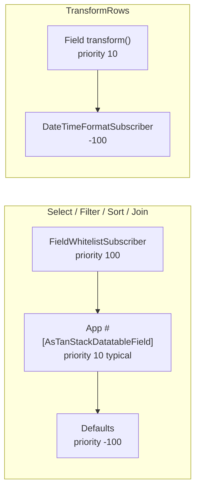

# Subscriber priorities

Order of whitelist → app `#[AsTanStackDatatableField]` → defaults for join / select /
filter / sort / transform. See also [Events & Subscribers](EVENTS.md) for the
doc index and [Custom field subscribers](CUSTOM_FIELD_SUBSCRIBERS.md) for app
handlers.

---

| Subscriber | Priority | Job |
|------------|----------|-----|
| `FieldWhitelistSubscriber` | `100` | Gate join/select/filter/sort |
| App `AbstractDatatableFieldSubscriber` | usually `10` | `join` / `select` / `filter` / `sort` / `transform` |
| `DefaultJoinSubscriber` | `-100` | LEFT/INNER JOIN via `LeftJoinApplicator` |
| `DefaultSelectSubscriber` | `-100` | `addSelect(expression AS field)` |
| `DefaultFilterSubscriber` | `-100` | Common operators |
| `DefaultSortSubscriber` | `-100` | `addOrderBy` |
| `DateTimeFormatSubscriber` | `-100` | Format dates from `datetime_formats` |

`ComputedFieldSubscriber` is an **example only** (excluded from DI) — copy into
the app.
